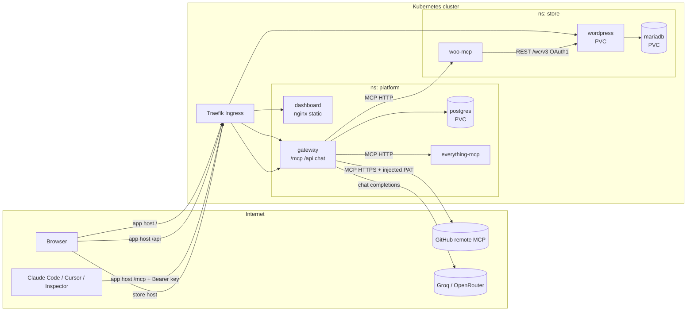
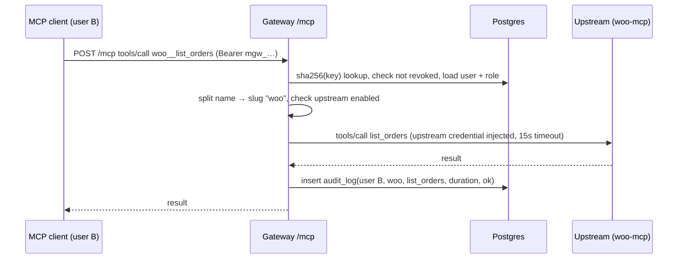

# Architecture

> Status: **implemented and verified on k3d** (2026-10-18; Phase 7 acceptance PASS). Short reviewer version: [docs/SYSTEM_DESIGN.md](docs/SYSTEM_DESIGN.md). Decisions referenced as `D-NNN` are in [`DECISIONS.md`](DECISIONS.md).

## 1. Layers
| # | Layer | Component | Responsibility |
|---|---|---|---|
| 1 | Store | `wordpress` (Apache as www-data on 8080) + `mariadb` (+ `wp-init` Job, + `store-assets` initContainer) | WooCommerce storefront (TATVA theme and catalogue, D-016), checkout (COD), admin, REST API |
| 2 | WooCommerce MCP server | `woo-mcp` | Exposes products and orders as MCP tools over Streamable HTTP; talks to WooCommerce REST (`/wp-json/wc/v3`) with OAuth 1.0a signing |
| 3 | Gateway + dashboard | `gateway` (Fastify) + `dashboard` (React static) + `postgres` | Gateway: one MCP endpoint aggregating upstream tools, upstream registry, auth (sessions + API keys), audit, REST API for the dashboard. Dashboard: UI only, no secrets. |
| 4 | Chat agent | module inside `gateway` | LLM tool loop; executes tools by calling the gateway's own `/mcp` as the logged-in user |
| – | Extra upstreams | `everything-mcp` (in-cluster), GitHub remote MCP (internet) | Additional servers for aggregation, collision and failure demos |

## 2. Component diagram

## 3. Public vs internal
| Exposed via Ingress | Internal only (ClusterIP + NetworkPolicy) |
|---|---|
| `store.<domain>` → wordpress (storefront, wp-admin) | `woo-mcp` (ingress allowed only from gateway pods) |
| `app.<domain>/` → dashboard | `everything-mcp` (gateway only) |
| `app.<domain>/api/*` → gateway REST | `mariadb` (wordpress + wp-init only) |
| `app.<domain>/mcp` → gateway MCP endpoint | `postgres` (gateway only) |

The dashboard and the gateway share the host `app.<domain>`, so the browser talks to one origin: the session cookie stays `SameSite=Strict` and no CORS is needed. The dashboard is static files behind nginx (no secrets, no outbound connections, CSP `default-src 'self'`); all logic and authorization live in the gateway. Both `/api` and `/mcp` are `Prefix` paths: Traefik orders routers by the length of the rule text, so an `Exact` `/mcp` would lose to the dashboard's `/` (UI-20).

Local domain: `*.127.0.0.1.nip.io` (resolves to 127.0.0.1, so no hosts-file edits are needed). VPS: `*.<ip>.sslip.io` or a real domain (D-010).

## 4. Key flows

### 4.1 External tool call

### 4.2 Chat agent
1. Browser `POST /api/chat` with the session cookie → the gateway resolves the user.
2. The gateway mints an internal token (HMAC with a per-process key, 5 min, `sub=user`, `src=chat`; `/mcp` accepts it only over loopback — D-018).
3. The agent opens an MCP client to `http://localhost:<port>/mcp` with that token, calls `tools/list`, and sends the tools to the LLM.
4. LLM tool_calls → `tools/call` on the gateway's `/mcp` → same auth, routing and audit path (`source=chat`).
5. The loop runs until there are no more tool calls (max 8 iterations). The response includes the transcript of tool calls for the UI.
6. Only the most relevant tools (size budget) are offered up front; the model reaches the rest through the local `find_tools` meta-tool (D-019), because 64 tool definitions do not fit a free-tier LLM's token limit.

### 4.3 Tool discovery and failure isolation
`tools/list` fans out to all enabled upstreams with `Promise.allSettled` and a 3 s timeout each. Results are cached per upstream (last-good list plus timestamp). An upstream that fails is omitted and marked Unreachable by the health loop (every 10 s). Calls to it return a clear MCP error (`upstream_unreachable` / `upstream_timeout`).

## 5. Persistence
| Store | Data | Volume |
|---|---|---|
| mariadb | WordPress/WooCommerce DB | PVC (local-path) |
| wordpress | `wp-content` (plugins, uploads) | PVC |
| postgres | users, invites, sessions, api_keys, upstreams (credential encrypted), audit_log | PVC |

## 6. Kubernetes topology
One umbrella chart `charts/platform`, with subcharts or templates per component, and two values files (`values-local.yaml`, `values-prod.yaml`). See [`docs/DEPLOYMENT.md`](docs/DEPLOYMENT.md).

| Differs by values | local (k3d) | prod (k3s VPS) |
|---|---|---|
| domains | `*.127.0.0.1.nip.io` | `*.<ip>.sslip.io` / real domain |
| TLS | off | cert-manager (REL-04) |
| image registry | `k3d image import` (pullPolicy Never/IfNotPresent) | `ghcr.io/ragx09/*` |
| storageClass | `local-path` | `local-path` |
| secrets | generated by `scripts/make-secrets.sh` | same script on the VPS, or `existingSecret` |
| resources | small | small to medium |

## 7. Trade-offs (summary; details in DECISIONS.md)
- Gateway, REST API and chat run in one deployable: less to build and deploy, at the cost of coarser scaling.
- Tool names are always namespaced (`slug__tool`): no ambiguity, but longer names.
- Stateless MCP: horizontally scalable, but no server-initiated notifications (we don't need them).
- Own Helm templates instead of Bitnami: more YAML, but no dependency on deprecated images.
- Storefront brand as code: theme + catalogue + images ship in a `store-assets` image and are imported idempotently by wp-init (D-016), at the cost of one more image to build and push.
