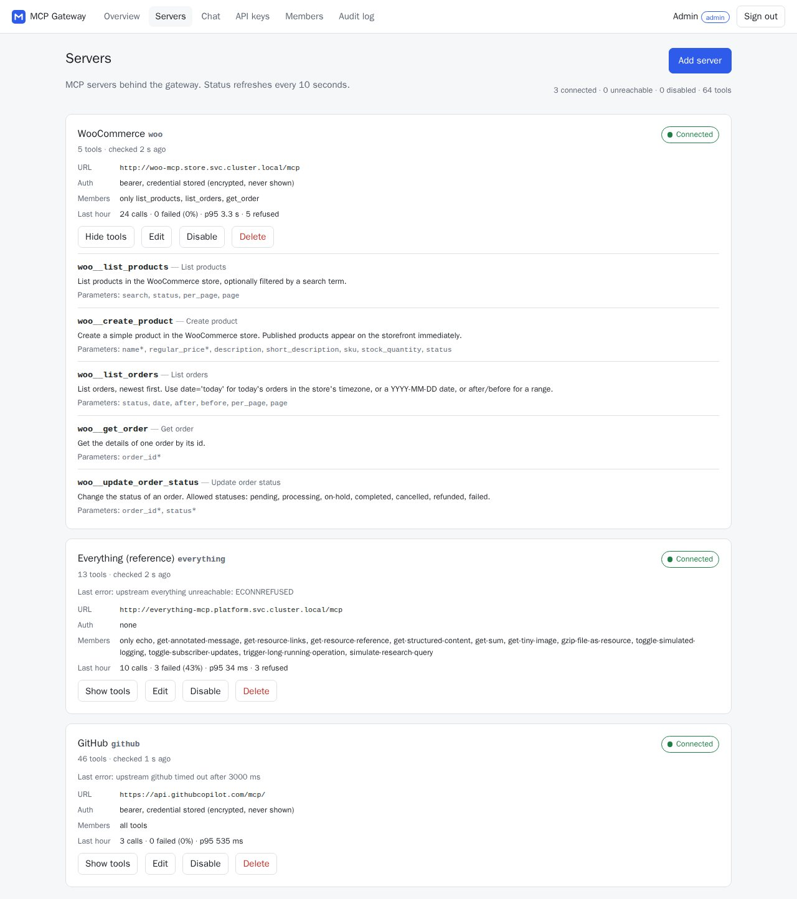
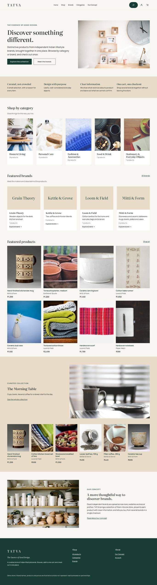
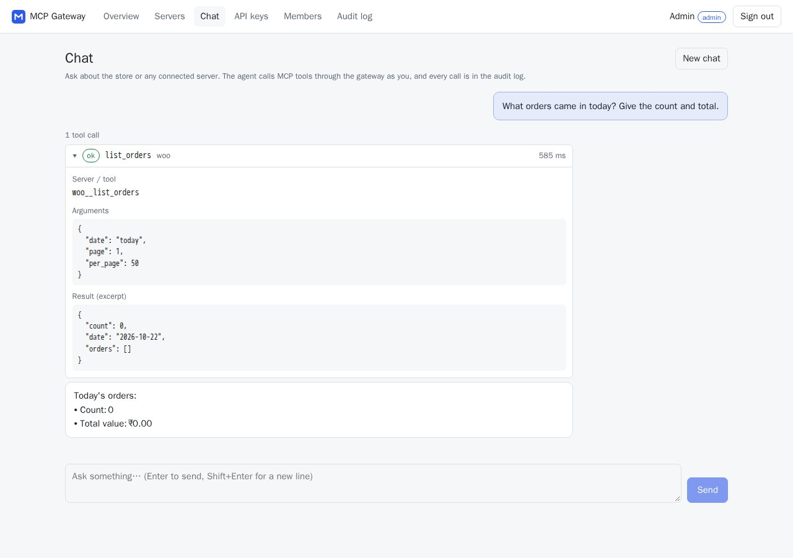
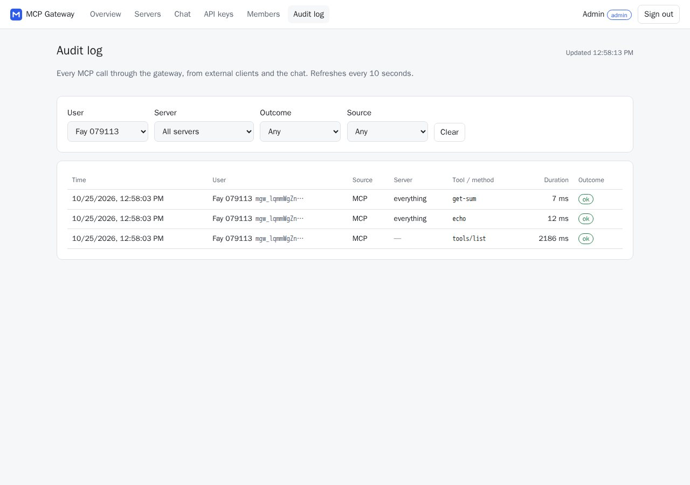
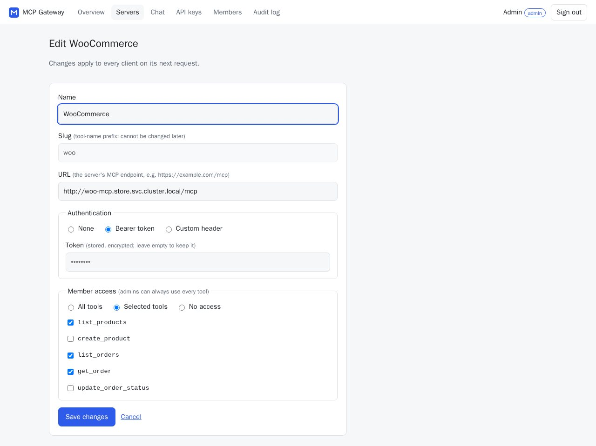
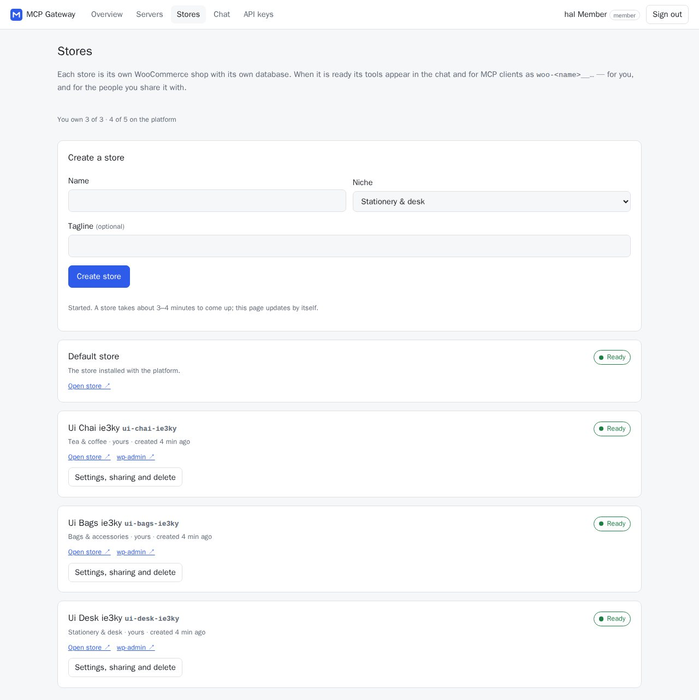
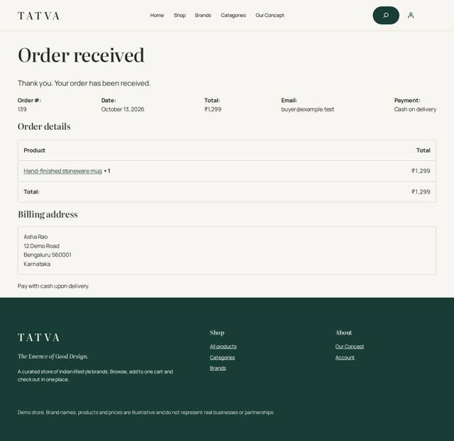

# WooCommerce Hosting + Team MCP Gateway

A WooCommerce store on Kubernetes, a self-written WooCommerce MCP server, and a **team MCP gateway**. An admin registers MCP servers once; every team member then uses all of them through **one MCP endpoint** (a personal API key or a browser login) or through a **chat agent** in the dashboard. Every call is attributed to a person and audited. The same Helm charts deploy to a local k3d cluster and to a k3s VPS.



> **Status (2026-10-26):** complete and verified on local k3d: every Definition-of-Done check passes (`scripts/e2e.sh all`), and all nine stand-out items plus the multi-store bonus are built and verified on k3d (table at the end). The VPS deployment is scripted (`vps-setup/`, `values-prod.yaml`) but **not yet run on a real VPS**; nothing in this README claims otherwise.
> Reviewer shortcuts: [System design and tradeoffs](docs/SYSTEM_DESIGN.md) · [Threat model](THREAT_MODEL.md) · [Security report](docs/SECURITY_REPORT.md) · [Demo runbook](docs/DEMO_RUNBOOK.md) · [How this was built](my-approach/README.md)

## What it is
| # | Layer | What it does | Code |
|---|---|---|---|
| 1 | **Store** | WordPress + WooCommerce + MariaDB on persistent volumes (INR store, branded TATVA theme, 50-product catalogue) | `charts/platform`, `charts/store`, `services/store-assets` |
| 2 | **WooCommerce MCP server** | Our own MCP server: products and orders as tools over the WooCommerce REST API (OAuth 1.0a signing); internal only | `services/woo-mcp` |
| 3 | **Gateway + dashboard** | One `/mcp` endpoint for the team: auth (API keys, OAuth), per-server tool permissions, credential injection, audit log, REST API, React dashboard with no secrets in the browser | `services/gateway`, `apps/dashboard` |
| 4 | **Chat agent** | An LLM tool loop that calls the gateway's own `/mcp` as the signed-in user, so it has exactly that user's tools | `services/gateway` (chat) |

```
MCP client / dashboard chat
        │  Authorization: Bearer mgw_… (or OAuth)
        ▼
  Traefik Ingress ──► gateway  ── key hash + role (Postgres) ── tool permission check
                         │         splits "woo__list_orders" → server "woo", tool "list_orders"
                         │         injects the upstream's own credential (the client never sees it)
                         ├──► woo-mcp (internal) ──► WooCommerce REST ──► MariaDB
                         ├──► everything-mcp (internal reference server)
                         ├──► GitHub remote MCP (internet; only the gateway has egress)
                         └──► hosted servers and extra stores (own namespaces, via the provisioner)
                      every call → one audit_log row (who, server, tool, duration, outcome)
```
Rules the design follows: everything goes through the gateway `/mcp`; authorization is enforced on the server, never only in the UI; API keys are stored as hashes; upstream credentials are encrypted at rest and never returned or forwarded; internal services stay internal (default-deny NetworkPolicies). Details: [ARCHITECTURE.md](ARCHITECTURE.md), [SYSTEM_DESIGN.md](docs/SYSTEM_DESIGN.md).

## Screenshots
| | |
|---|---|
|  **Storefront** (TATVA, INR, 5 categories) |  **Chat agent**: a tool call through the gateway, shown with arguments and result |
|  **Audit log**: every MCP call attributed to a user and key |  **Tool permissions**: members get read-only tools on `woo` |
|  **Multi-store**: each store has its own namespace, database and MCP tools |  **Order placed** on the storefront (cash on delivery) |

More: [dashboard overview](docs/screenshots/04-dashboard-overview.jpg), [hosted MCP servers](docs/screenshots/10-hosted-servers.jpg), [product page](docs/screenshots/02-storefront-product.jpg), [mobile dashboard](docs/screenshots/11-mobile-dashboard.jpg). Captured from the local k3d cluster with `scripts/dashboard-screens.sh` and `scripts/storefront-screens.sh`; all data is synthetic and no secrets are shown.

## Quick start (local)
```bash
cp .env.example .env     # add LLM_API_KEY (Groq or OpenRouter) and, optionally, GITHUB_MCP_PAT
scripts/up.sh            # k3d cluster → Secrets → images → Helm → wait (6–12 min first time)
node scripts/seed-demo-users.mjs --key     # demo users A (admin) and B (member) + one API key for B
scripts/e2e.sh all       # every automatable Definition-of-Done check (PASS/FAIL lines)
```
Then open http://store.127.0.0.1.nip.io (storefront) and http://app.127.0.0.1.nip.io (dashboard). Full steps, URLs and passwords are in **Local setup** below. Tests that need no cluster: `npm run typecheck` and, per workspace, `npm test` (woo-mcp 30, gateway 122, dashboard 30 unit tests, last run 2026-10-26).

## Project tracker
```bash
npm run tracker            # regenerate tracker/data.js from the Markdown docs
# then open tracker/index.html in a browser (works from the file system)
```

## Local setup
Prerequisites: Docker (Desktop) running, `kubectl`, `helm` v3, `k3d` v5, Node 24, and a `.env` copied from `.env.example` (gitignored; see the comments in it). From the repository root:

```bash
scripts/up.sh            # create/start the k3d cluster, Secrets, build + import images, helm install, wait (~6–12 min the first time, depending on image builds; ~1 min after)
k3d cluster stop mcp     # pause (keeps all data); `k3d cluster start mcp` or `scripts/up.sh` to resume
scripts/down.sh          # remove the release, keep cluster, Secrets and data
scripts/down.sh --all    # delete the cluster and ALL data
```
`up.sh` is safe to re-run: existing Secrets are kept, and unchanged code gives the same image tag, so nothing restarts. After code changes: `SERVICES=gateway scripts/build-images.sh && scripts/deploy.sh local` (or `SERVICES=dashboard`, …). Dashboard development with hot reload against k3d: `npm run dev -w apps/dashboard` (proxies `/api` to the cluster).

| What | URL |
|---|---|
| Storefront | http://store.127.0.0.1.nip.io |
| WP admin (user `admin`) | http://store.127.0.0.1.nip.io/wp-admin — password: `kubectl -n store get secret wordpress-admin -o jsonpath='{.data.admin-password}' \| base64 -d` |
| Dashboard | http://app.127.0.0.1.nip.io — admin `admin@tatva.shop`, password: `kubectl -n platform get secret gateway-admin -o jsonpath='{.data.admin-password}' \| base64 -d` |
| Gateway MCP endpoint | http://app.127.0.0.1.nip.io/mcp — personal API key: `node scripts/lib/gateway-key.mjs create my-laptop` (prints `<id> <key>`; see docs/DEPLOYMENT.md) |

More detail: [`docs/DEPLOYMENT.md`](docs/DEPLOYMENT.md).

## VPS (k3s) setup
> Scripted in [`vps-setup/`](vps-setup/); **not yet run on a real VPS** (JarvisLabs CPU VM chosen, waiting for credits). Specs, costs, setup log: [`vps-setup/VPS.md`](vps-setup/VPS.md).

Needs Ubuntu LTS, x86_64, 2 vCPU / 8 GB (demo: default store + 1 extra; 4 vCPU / 16 GB for more stores), ≥ 100 GB disk; TCP 22/80/443 open (keep 6443 closed).
```bash
jl setup                     # once: JarvisLabs CLI sign-in (uv tool install jarvislabs)
vps-setup/up.sh              # VM → preflight → k3s → SSH tunnel → images → cert-manager → Secrets → Helm (values-prod) → TLS → demo users
vps-setup/ssh.sh status      # VM, tunnel and node
vps-setup/down.sh            # destroy the VM (stop billing)   ·   --pause to keep the disk
```
What differs from local is only Helm values (`charts/platform/values-prod.yaml`): domain, https + cert-manager issuer (Secure cookies follow), registry prefix, storage sizes and resources. Images are the same content-addressed tags as local, streamed into k3s's containerd over SSH (D-023), so no registry is needed. Upgrade and rollback: `helm history platform` / `helm rollback platform <rev>` ([DEPLOYMENT.md](docs/DEPLOYMENT.md) §6).

## Using the system

### Place an order
Open the storefront (local: http://store.127.0.0.1.nip.io), pick a product → **Add to cart** → **Checkout** → fill in an Indian address (the store is in INR, Karnataka) → payment **Cash on delivery** → **Place order**. The order appears in wp-admin → **WooCommerce → Orders** (as *Processing*). Scripted in a real browser: `scripts/e2e-checkout.sh` (also confirms the order in wp-admin).

### Demo users (A and B)
`node scripts/seed-demo-users.mjs --key` makes sure user **A** (the seeded admin, Secret `platform/gateway-admin`) and user **B** (a member, invited and accepted through the normal flow; password in Secret `platform/demo-users`) exist, and prints a fresh API key for B **once**. Any user can also create their own key in the dashboard → **API keys**. Keys are shown once and stored only as a hash.

### Connect an external MCP client
All a client needs is the gateway URL and either a personal key or a browser login (OAuth, below). Local k3d: `http://app.127.0.0.1.nip.io/mcp` (works from WSL and from Windows, nip.io resolves to 127.0.0.1); VPS: `https://app.<domain>/mcp`. Transport: Streamable HTTP. Every tool is named `<server>__<tool>` (e.g. `woo__list_orders`, `github__get_me`).

**Claude Code**
```bash
claude mcp add --transport http mcp-gateway http://app.127.0.0.1.nip.io/mcp \
  --header "Authorization: Bearer mgw_…your key…"
claude mcp list                     # mcp-gateway … ✔ Connected
claude                              # then ask: "What orders came in today in the store?"
```
Or without changing your Claude Code config, with a file (keep it out of git, it holds the key):
```json
{ "mcpServers": { "mcp-gateway": { "type": "http", "url": "http://app.127.0.0.1.nip.io/mcp",
    "headers": { "Authorization": "Bearer mgw_…your key…" } } } }
```
`claude --mcp-config gateway.json --strict-mcp-config`

**Cursor** — `~/.cursor/mcp.json` (or `.cursor/mcp.json` in a project), then Settings → MCP shows the tools:
```json
{ "mcpServers": { "mcp-gateway": { "url": "http://app.127.0.0.1.nip.io/mcp",
    "headers": { "Authorization": "Bearer mgw_…your key…" } } } }
```

**MCP Inspector**
```bash
# UI: choose Transport "Streamable HTTP", URL as above, add header Authorization: Bearer mgw_…
npx @modelcontextprotocol/inspector@2.10.1
# CLI:
npx @modelcontextprotocol/inspector@2.10.1 --cli http://app.127.0.0.1.nip.io/mcp --transport http \
  --header "Authorization: Bearer mgw_…" --method tools/list
npx @modelcontextprotocol/inspector@2.10.1 --cli http://app.127.0.0.1.nip.io/mcp --transport http \
  --header "Authorization: Bearer mgw_…" --method tools/call --tool-name woo__list_orders --tool-arg date=today
```
**Connect with browser login (OAuth, no key)** — clients that support MCP OAuth (Claude Code, MCP Inspector) need only the URL:
```bash
claude mcp add --transport http mcp-gateway http://app.127.0.0.1.nip.io/mcp
claude            # /mcp → mcp-gateway → Authenticate: the browser opens the dashboard; sign in and Approve
```
The client registers itself, logs you in with PKCE and keeps a 1-hour token it refreshes on its own. Calls are logged under your name with source `oauth`; **API keys → Connected apps** lists the apps you approved and revokes them (the next call gets 401). Admins see everyone's apps.

Without a key, or with a revoked key, `/mcp` answers 401. Disabled servers' tools are not listed. Every call is in the dashboard → **Audit log** under your name.

### Chat agent
Dashboard → **Chat** (signed in as any user). Try "What orders came in today?", and as an admin "Create a product called Demo Candle priced 499". The chat uses the same gateway `/mcp` with your identity, so it has exactly your tools; its calls are audited with source `chat`.

### Tool permissions
Admins choose per server what members may use: dashboard → **Servers** → **Edit** → **Member access** (all tools, selected tools, or no access). A fresh install lets members only read the store (`woo__list_products`, `woo__list_orders`, `woo__get_order`; Helm `gateway.seed.woo.memberTools`); creating products and changing order status stay with admins. Hidden tools are not listed and are refused if called directly — through an API key or the chat alike.

### Stores (multi-store bonus)
Dashboard → **Stores** (any signed-in user): name + niche (stationery, tea & coffee, home & ceramics, bags, bike accessories, or your own) → **Create store**. It gets its own namespace, database, volumes, Secrets and host `<name>.store.<domain>`, shows *Creating… → Ready* (or *Failed* with the reason) and its MCP tools appear as `woo-<name>__…` for you, with no manual step. Limits: 3 stores per member, 5 in total. **Settings** shows the wp-admin password once (admins can reset it), shares the store with teammates (read-only tools by default, widened per store) and deletes it (type its name): its tools vanish at once and the namespace, volumes, Secrets and registration are removed. Admins also see pods and quota per store; a store whose namespace is removed outside the platform turns Failed (never silently dropped). Scripted proof: `scripts/e2e.sh stores`, the page: `scripts/dashboard-screens.sh stores`; isolation probes: `scripts/k8s-checks.sh stores`. Design: [D-026](DECISIONS.md), [D-028](DECISIONS.md), MCP_DESIGN §16.

### Hosted MCP servers (stand-out 5)
Dashboard → **Servers** → *Hosted servers* → **Add by image** (admins): image from an allowed registry (Helm `provisioner.hosted.imageRegistries`; fixed tag or digest, never `:latest`), port, path, plain and secret environment. The platform runs it in its own `hosted-<name>` namespace — non-root, read-only, no token, quota, reachable only from the gateway, no outbound network unless ticked — and registers it as a server; members see nothing until an admin allows tools. Delete removes namespace, Secret, Service and registration. Scripted proof: `scripts/e2e.sh hosted`; isolation probes: `scripts/k8s-checks.sh hosted`. Design: [D-029](DECISIONS.md), MCP_DESIGN §17.

### Acceptance checks
`scripts/e2e.sh all` runs every automatable Definition-of-Done check (chat flow with the real LLM, A/B users, external key, revoke, disable, kill pod, audit attribution) and prints PASS/FAIL lines; `GITHUB_REPO=owner/repo` adds the cross-server GitHub issue. `scripts/e2e.sh oauth`, `stores` (about 8 minutes) and `hosted` cover the OAuth login, multi-store and hosted-server checks. Manual steps and the full demo script: [docs/DEMO_RUNBOOK.md](docs/DEMO_RUNBOOK.md); recording plan: [docs/VIDEO_PLAN.md](docs/VIDEO_PLAN.md).

## Documentation
| Doc | Purpose |
|---|---|
| [SPEC.md](SPEC.md) | requirements with IDs |
| [ARCHITECTURE.md](ARCHITECTURE.md) | components and flows |
| [DECISIONS.md](DECISIONS.md) | decision log |
| [THREAT_MODEL.md](THREAT_MODEL.md) | security model |
| [TEST_PLAN.md](TEST_PLAN.md) | test strategy |
| [TASKS.md](TASKS.md) | roadmap and status |
| [docs/SYSTEM_DESIGN.md](docs/SYSTEM_DESIGN.md) | the short "System design and tradeoffs" note |
| [docs/SECURITY_REPORT.md](docs/SECURITY_REPORT.md) | security report: what was tried, found, fixed, accepted, and still unproven |
| [docs/](docs) | MCP design, API contracts, deployment, demo runbook, traceability, security testing ([rules](docs/SECURITY_TESTING.md), [findings](docs/SECURITY_FINDINGS.md), [red-team brief](docs/RED_TEAM_BRIEF.md)) |
| [brand/](brand) | Storefront brand material (current working concept: TATVA) |
| [knowledge/](knowledge) | learning notes |
| [docs/screenshots/](docs/screenshots) | the screenshots used above |
| [my-approach/](my-approach/README.md) | how this project was built: working method, use of AI agents, personal notes |

## Bonus / stand-out items attempted
Status words: **verified on k3d** = scripted check passed on a real cluster (evidence in TASKS.md); **built, cluster run pending** = code, unit/integration tests and a real-browser run exist, the cluster script is written but has not been run yet; **prepared** = scripts and values ready, nothing deployed.

| Item (problem statement § "Other ways to stand out") | Status | What was built | Where |
|---|---|---|---|
| 1) Production-like VPS deployment | prepared | Same charts with `charts/platform/values-prod.yaml` (only domain, TLS, registry, storage, resources differ — `scripts/check-chart.sh` fails otherwise), k3s install script, cert-manager TLS, Traefik `externalTrafficPolicy: Local`; **not deployed** (no VPS credits yet) | [DEPLOYMENT.md](docs/DEPLOYMENT.md) §5, `vps-setup/`, REL-01..06 |
| 2) Tool permissions | verified on k3d | Per server, admins choose what members may use (all, none, or selected tools); hidden from `tools/list` and refused on `tools/call` for API keys, OAuth and the chat alike, refusals audited; woo is members-read-only on a fresh install | D-021, `services/gateway/src/authz/tool-access.ts`, MCP_DESIGN §13 |
| 3) OAuth | verified on k3d | MCP authorization spec on the gateway: discovery metadata, dynamic client registration, code + PKCE S256, consent in the dashboard, rotated refresh tokens, resource-bound tokens, revocable grants; API keys unchanged | D-027, `services/gateway/src/oauth/`, `scripts/e2e.sh oauth` |
| 4) Handling many tools | verified on k3d | 64 tools from 3 servers do not fit a free-tier LLM: the chat offers the most relevant tools within a size budget plus a `find_tools` meta-tool that searches the full list and makes matches callable | D-019, `services/gateway/src/chat/agent.ts`, MCP_DESIGN §10 |
| 5) Hosted MCP servers by image | verified on k3d | Admin adds an image from an allowed registry; the provisioner runs it in its own namespace with its own Secret, quota, default-deny NetworkPolicy (gateway-only ingress, no egress by default), non-root/read-only/no token; registered with no credential and members none; clean removal. Registry allowlist and secrets handling int-tested (9/9), provisioner unit-tested, UI driven in a real browser. Verified on k3d (2026-10-26): `scripts/e2e.sh hosted` 25/25, `scripts/k8s-checks.sh hosted` 20/0, `scripts/dashboard-screens.sh hosted` 10/10 | D-029, `charts/hosted`, `services/provisioner/src/hosted.ts`, `services/gateway/src/hosted/`, MCP_DESIGN §17, `scripts/e2e.sh hosted`, `scripts/k8s-checks.sh hosted` |
| 6) Security hardening — SSRF | verified on k3d | URL guard on save **and** on every connection (private/loopback/metadata ranges, DNS-rebinding safe, redirects refused, host allowlist) | `services/gateway/src/upstreams/ssrf.ts`, MCP_DESIGN §12, TC-SEC-01 |
| 6) Security hardening — least-privilege RBAC | verified on k3d | Only the provisioner has a Kubernetes account: namespaces + RoleBindings cluster-wide, `bind` limited to `store-manager` / `hosted-manager`, a ValidatingAdmissionPolicy confines it to labelled `store-*` / `hosted-*` namespaces; the gateway and every other pod mount no token | `charts/platform/templates/rbac-provisioner.yaml`, `scripts/k8s-checks.sh rbac` (47 checks on k3d incl. hosted), D-026, THREAT_MODEL T-29/T-32 |
| 6) Security hardening — NetworkPolicy, non-root, images | verified on k3d | Default-deny NetworkPolicies in both directions (only the gateway reaches the internet, and only public addresses), verified with probe pods; every container non-root, read-only root, no capabilities, CPU and memory limits, a token-less `workload` ServiceAccount; namespaces enforce Pod Security `restricted`; our images scan 0 CRITICAL / 0 HIGH (Trivy); WordPress without user enumeration, XML-RPC or version banners; every red-team finding fixed or accepted with a reason | `charts/*/templates/networkpolicies.yaml`, `scripts/k8s-checks.sh netpol`, `scripts/lib/chart-policy.py`, [SECURITY_FINDINGS.md](docs/SECURITY_FINDINGS.md) |
| 6) Security hardening — encrypted credentials | verified on k3d | Upstream credentials AES-256-GCM at rest, write-only in the API; hosted servers' secret variables encrypted with a key derived from the provisioner key and held in a Secret only | `services/gateway/src/crypto/credentials.ts`, THREAT_MODEL T-03/T-32 |
| 6) Security hardening — tested, not just built | verified on k3d | Formal security testing: WPScan/nuclei/nikto, ZAP, 55 live auth/IDOR/CSRF tests, a hostile upstream (36 checks), Trivy, kubescape, a 49-probe rogue-pod matrix, and an attacker-LLM loop; every finding fixed or accepted with a reason | [SECURITY_TESTING.md](docs/SECURITY_TESTING.md), [SECURITY_FINDINGS.md](docs/SECURITY_FINDINGS.md), [RED_TEAM_BRIEF.md](docs/RED_TEAM_BRIEF.md) |
| 7) Scaling — replicas and rate limits | verified on k3d | Gateway runs 2 replicas (PDB, rolling update, preStop pause: a pod killed under load loses no request); per-key and per-user `/mcp` budgets and the chat's per-user limits are shared through Postgres, so they hold whichever replica answers; login limits per IP+email and per IP | D-022, `services/gateway/src/ratelimit.ts`, `scripts/k8s-checks.sh replicas`, THREAT_MODEL T-13/T-23 |
| 8) Observability — metrics | verified on k3d | Prometheus `/metrics` on an internal port (scraper-label NetworkPolicy, not in the Ingress): calls by server/outcome/source, latency histogram, upstream up; Servers page shows last-hour calls, failure %, p95 and refusals per server from the audit log (all replicas) | `services/gateway/src/metrics.ts`, MCP_DESIGN §14, `scripts/k8s-checks.sh metrics` |
| 8) Observability — clear failure reasons | verified on k3d (servers, calls); built for stores and hosted servers | Servers page shows Connected/Unreachable/Disabled with the last error; calls fail with readable `upstream_unreachable` / `upstream_timeout` / `upstream_disabled`; audit log with outcome per call; stores and hosted servers say why they failed (image pull, crash loop, quota, timeout) | UI-04, UI-18, MCP_DESIGN §4a/§6/§17 |
| 9) Upgrades and rollback | verified on k3d | Documented and verified (upgrade → `helm rollback` → data intact) | [DEPLOYMENT.md](docs/DEPLOYMENT.md) §6 |
| Bonus: multi-store provisioning | verified on k3d | A provisioner (the only component with Kubernetes rights) runs `charts/store` per store in `store-<name>`; stores differ by name, tagline, niche catalogue and accent; MCP server registered automatically as `woo-<name>__…`; per-store owner / access list / tool rule; caps 3 per member and 5 total counted under a lock; quota + LimitRange + provisioning timeout; retry-safe and restart-safe. Verified on k3d (2026-10-26): `scripts/e2e.sh stores` 31/31 (provisioner killed mid-create, tools appear with no manual step, member access, orders in two niche stores, the chat compares them against each MariaDB, delete leaves no trace), `scripts/k8s-checks.sh stores` 34/0 (cross-store isolation, quota, Pod Security), `scripts/dashboard-screens.sh stores` 15/15 (three at once, cap, one-time password, share, delete), RBAC matrix. Bike-accessories catalogue (BON-17): 50/50 images, verified on a newly created store | D-026, D-028, `services/provisioner/`, `charts/store`, `services/gateway/src/stores/`, MCP_DESIGN §16, DEMO_RUNBOOK §8 |
| Extra: storefront brand | verified on k3d | The demo store is a branded shop (TATVA: child theme, 50-product INR catalogue, per-store niches) rather than a blank WooCommerce | `brand/`, `charts/store`, TASKS Phase 9 |

Not attempted: none of the nine stand-out items is skipped. Open work is listed in [TASKS.md](TASKS.md) and [docs/PROGRESS.md](docs/PROGRESS.md): the VPS deployment, TLS checks on the VPS (SEC-07).
