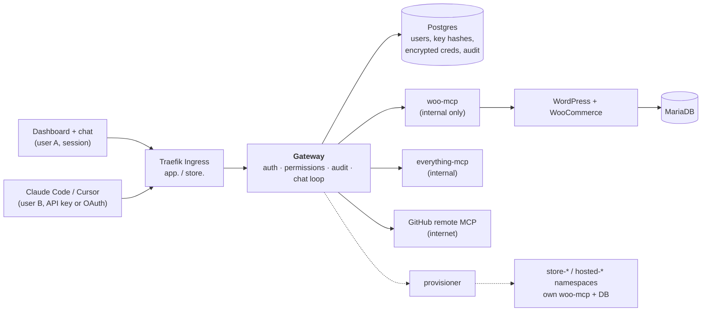

# WooCommerce Hosting + Team MCP Gateway

A WooCommerce store on Kubernetes, a self-written WooCommerce MCP server, and a **team MCP gateway**. An admin registers MCP servers once; every team member then uses all of them through **one MCP endpoint** (personal API key or browser login) or a **chat agent** in the dashboard. Every call is attributed to a person and audited. The same Helm charts deploy to a local k3d cluster and to a k3s VPS.


> **Status (2026-10-26):** complete and verified on local k3d (`scripts/e2e.sh all`) **and on a real k3s VPS over HTTPS** (Let's Encrypt; e2e 26 pass / 0 fail, OAuth, chat, data persistence after pod deletion). All nine stand-out items and the multi-store bonus are built and verified. The VPS runs only while recording and presenting (see [live demo](#live-demo-environment)).
> Reviewer shortcuts: [System design](docs/SYSTEM_DESIGN.md) · [Threat model](THREAT_MODEL.md) · [Security report](docs/SECURITY_REPORT.md) · [Demo runbook](docs/DEMO_RUNBOOK.md) · [How this was built](my-approach/README.md)

## Architecture



| Component | Role | Code |
|---|---|---|
| **Store** | WordPress + WooCommerce + MariaDB on persistent volumes (INR, branded TATVA theme, 50-product catalogue) | `charts/platform`, `charts/store` |
| **woo-mcp** | My MCP server: products and orders as tools over the WooCommerce REST API (OAuth 1.0a); internal only | `services/woo-mcp` |
| **Gateway** | One `/mcp` endpoint: API keys + OAuth, per-server tool permissions, credential injection, audit log, REST API | `services/gateway` |
| **Dashboard** | React UI: servers, users, keys, permissions, audit, stores, chat. No secrets in the browser | `apps/dashboard` |
| **Chat agent** | LLM tool loop that calls the gateway's own `/mcp` as the signed-in user, so it has exactly that user's tools | `services/gateway/src/chat` |
| **Provisioner** | The only component with Kubernetes rights; creates extra stores and hosted MCP servers in their own namespaces | `services/provisioner`, `charts/hosted` |

Tools are named `<server>__<tool>` (e.g. `woo__list_orders`); the gateway splits the name, checks permission, injects the upstream's own credential and writes one audit row per call.

**Security rules the design follows:** everything goes through the gateway `/mcp`; authorization is enforced on the server, never only in the UI; API keys are stored as hashes; upstream credentials are AES-256-GCM encrypted and never returned or forwarded; internal services stay internal (default-deny NetworkPolicies); every workload is non-root with probes, requests and limits. More: [ARCHITECTURE.md](ARCHITECTURE.md), [SYSTEM_DESIGN.md](docs/SYSTEM_DESIGN.md).

## Quick start (local)
Prerequisites: Docker running, `kubectl`, `helm` v3, `k3d` v5, Node 24.
```bash
cp .env.example .env                       # add LLM_API_KEY (Groq or OpenRouter); GITHUB_MCP_PAT optional
scripts/up.sh                              # k3d cluster → Secrets → images → Helm → wait (6–12 min first time)
node scripts/seed-demo-users.mjs --key     # user A (admin), user B (member) and one API key for B
scripts/e2e.sh all                         # every automatable Definition-of-Done check (PASS/FAIL lines)
```
| What | URL / how |
|---|---|
| Storefront | http://store.127.0.0.1.nip.io |
| WP admin (`admin`) | `/wp-admin`; password: `kubectl -n store get secret wordpress-admin -o jsonpath='{.data.admin-password}' \| base64 -d` |
| Dashboard | http://app.127.0.0.1.nip.io: `admin@tatva.shop`; password: `kubectl -n platform get secret gateway-admin -o jsonpath='{.data.admin-password}' \| base64 -d` |
| MCP endpoint | http://app.127.0.0.1.nip.io/mcp: key via `node scripts/lib/gateway-key.mjs create my-laptop` |

Pause with `k3d cluster stop mcp`; `scripts/down.sh` removes the release; `scripts/down.sh --all` deletes the cluster and all data. After code changes: `SERVICES=gateway scripts/build-images.sh && scripts/deploy.sh local`. Unit tests (no cluster): `npm run typecheck` and `npm test` per workspace (woo-mcp 32, gateway 122, dashboard 30). Details: [DEPLOYMENT.md](docs/DEPLOYMENT.md).

## VPS (k3s) setup
Needs Ubuntu LTS x86_64, 2 vCPU / 8 GB, ≥ 100 GB disk, TCP 22/80/443 open, a domain (DuckDNS works). Scripts and the running log are in [`vps-setup/`](vps-setup/) ([VPS.md](vps-setup/VPS.md)).
```bash
jl setup                 # once: JarvisLabs CLI sign-in
vps-setup/up.sh          # VM → k3s → images → cert-manager → Secrets → Helm (values-prod) → TLS → demo users
vps-setup/down.sh        # destroy the VM and stop billing (--pause keeps the disk)
```
Only Helm values differ from local (`charts/platform/values-prod.yaml`: domain, HTTPS issuer, storage, resources). Images are the same content-addressed tags, streamed into k3s over SSH, so no registry is needed. Upgrade/rollback: `helm history platform` / `helm rollback platform <rev>`.

### Live demo environment
The VM costs about ₹5.3/hour, so it runs **only while recording and presenting**; `up.sh` creates it and `down.sh` destroys it. The address is fixed by DuckDNS: `https://app.woo-commerce-demo.duckdns.org` (dashboard) and `https://store.woo-commerce-demo.duckdns.org` (store), with Let's Encrypt certificates. Each session starts from a fresh install with demo users and sample data created by the scripts. Outside a session the address does not answer; the screenshots, the video and the local setup show the same system. Secrets live once in a gitignored `.env` and become Kubernetes Secrets; they are never committed, logged or shown.

## Using the system
**Place an order.** Storefront → product → **Add to cart** → **Checkout** → Indian address → **Cash on delivery** → **Place order**. It shows up in wp-admin → WooCommerce → Orders. Scripted: `scripts/e2e-checkout.sh`.

**Connect an external MCP client.** Needs the gateway URL (`http://app.127.0.0.1.nip.io/mcp` locally, `https://app.<domain>/mcp` on the VPS) and a personal key (dashboard → **API keys**, shown once, stored hashed) or a browser login.
```bash
# Claude Code (API key)
claude mcp add --transport http mcp-gateway http://app.127.0.0.1.nip.io/mcp \
  --header "Authorization: Bearer mgw_…your key…"
claude mcp list                            # mcp-gateway … ✔ Connected

# Claude Code (browser login, no key): then /mcp → mcp-gateway → Authenticate
claude mcp add --transport http mcp-gateway http://app.127.0.0.1.nip.io/mcp

# MCP Inspector
npx @modelcontextprotocol/inspector@2.10.1 --cli http://app.127.0.0.1.nip.io/mcp --transport http \
  --header "Authorization: Bearer mgw_…" --method tools/list
```
Cursor: add `{ "mcpServers": { "mcp-gateway": { "url": "…/mcp", "headers": { "Authorization": "Bearer mgw_…" } } } }` to `~/.cursor/mcp.json`. OAuth clients register themselves, use PKCE and refresh a 1-hour token; approved apps are listed and revocable under **API keys → Connected apps**. Without a key, or with a revoked one, `/mcp` answers 401. Every call appears in **Audit log** under your name.

**Chat agent.** Dashboard → **Chat**. Try "What orders came in today?" and, as admin, "Create a product called Demo Candle priced 499". It uses the same `/mcp` with your identity, so it has exactly your tools; calls are audited with source `chat`.

**Tool permissions.** Servers → **Edit** → **Member access** (all, selected or no tools). On a fresh install members can only read the store; creating products and changing orders stay with admins. Hidden tools are not listed and are refused if called directly, by key or chat alike.

**Stores (multi-store bonus).** Dashboard → **Stores** → name + niche → **Create store**: own namespace, database, volumes, host `<name>.store.<domain>` and `woo-<name>__…` tools, with no manual step. Limits: 3 per member, 5 total. Delete removes everything.

**Hosted MCP servers.** Servers → *Hosted servers* → **Add by image** (admin): image from an allowed registry, run non-root in its own namespace, reachable only from the gateway.

**Acceptance checks.** `scripts/e2e.sh all` (chat with the real LLM, A/B users, key, revoke, disable, kill pod, audit attribution); `oauth`, `stores` and `hosted` cover those features. Full script: [DEMO_RUNBOOK.md](docs/DEMO_RUNBOOK.md).

## Screenshots
| | |
|---|---|
|  **Storefront** (TATVA, INR) |  **Chat agent** calling `woo__list_orders` |
|  **Audit log**: every call attributed |  **Tool permissions** per server |
|  **Multi-store**: one namespace and DB each |  **Order placed** (cash on delivery) |

## Deliverables
| Deliverable (problem statement) | Where |
|---|---|
| README: local setup, VPS setup, place an order, connect an MCP client, use the chat agent | this file |
| Source: dashboard, gateway, WooCommerce MCP server, chat agent | `apps/dashboard`, `services/gateway`, `services/woo-mcp`, `services/provisioner` |
| Helm charts, local and production values | `charts/platform` (`values-local.yaml`, `values-prod.yaml`), `charts/store`, `charts/hosted` |
| "System design and tradeoffs" note | [docs/SYSTEM_DESIGN.md](docs/SYSTEM_DESIGN.md) |
| Threat model note (the four required questions) | [THREAT_MODEL.md](THREAT_MODEL.md) §4 |
| Bonus and stand-out items | [table below](#bonus--stand-out-items) |
| Demo video | plan in [docs/VIDEO_PLAN.md](docs/VIDEO_PLAN.md); link added here once recorded |

## Bonus / stand-out items
All verified on k3d with scripted checks (evidence in [TASKS.md](TASKS.md)); item 1 also on the VPS.

| Item | What was built | Where |
|---|---|---|
| 1) Production-like VPS | Same charts + `values-prod.yaml`, k3s, cert-manager TLS, verified over HTTPS with persistence | `vps-setup/`, [DEPLOYMENT.md](docs/DEPLOYMENT.md) |
| 2) Tool permissions | Per server: all / none / selected tools for members; enforced for keys, OAuth and chat; refusals audited | D-021, `services/gateway/src/authz/` |
| 3) OAuth | MCP authorization spec: discovery, dynamic client registration, code + PKCE, consent, revocable grants | D-027, `services/gateway/src/oauth/` |
| 4) Many tools | 64 tools exceed a free-tier LLM: chat offers the most relevant within a budget plus a `find_tools` meta-tool | D-019, `chat/agent.ts` |
| 5) Hosted MCP servers | Run an image from an allowed registry in its own locked-down namespace; clean removal | D-029, `charts/hosted` |
| 6) Security hardening | SSRF guard, least-privilege RBAC (only the provisioner has a token), default-deny NetworkPolicies, encrypted credentials, Pod Security `restricted`, Trivy 0 HIGH/CRITICAL, red-team testing with every finding fixed or accepted | [SECURITY_REPORT.md](docs/SECURITY_REPORT.md), `scripts/k8s-checks.sh` |
| 7) Scaling | 2 gateway replicas (PDB, rolling update, no lost request when a pod dies); rate limits shared through Postgres | D-022, `ratelimit.ts` |
| 8) Observability | Prometheus `/metrics` on an internal port; per-server calls, failure %, p95; readable failure reasons | `metrics.ts`, MCP_DESIGN §14 |
| 9) Upgrades and rollback | `helm upgrade` → `helm rollback` with data intact | [DEPLOYMENT.md](docs/DEPLOYMENT.md) §6 |
| Bonus: multi-store | Provisioner runs `charts/store` per store; auto-registered tools; per-store access; quotas and caps | D-026, D-028, `services/provisioner/` |
| Extra: brand | TATVA storefront: child theme, 50-product INR catalogue, per-store niches | `brand/` |

Open work: SEC-07 TLS checks, demo rehearsal, video and submission ([TASKS.md](TASKS.md), [docs/PROGRESS.md](docs/PROGRESS.md)).

## Documentation
[SPEC](SPEC.md) · [ARCHITECTURE](ARCHITECTURE.md) · [DECISIONS](DECISIONS.md) · [THREAT_MODEL](THREAT_MODEL.md) · [TEST_PLAN](TEST_PLAN.md) · [TASKS](TASKS.md) · [docs/](docs) (MCP design, API contracts, deployment, runbook, traceability, security testing) · [brand/](brand) · [knowledge/](knowledge) (learning notes) · [my-approach/](my-approach/README.md) · `npm run tracker` then open `tracker/index.html` for the visual tracker.
